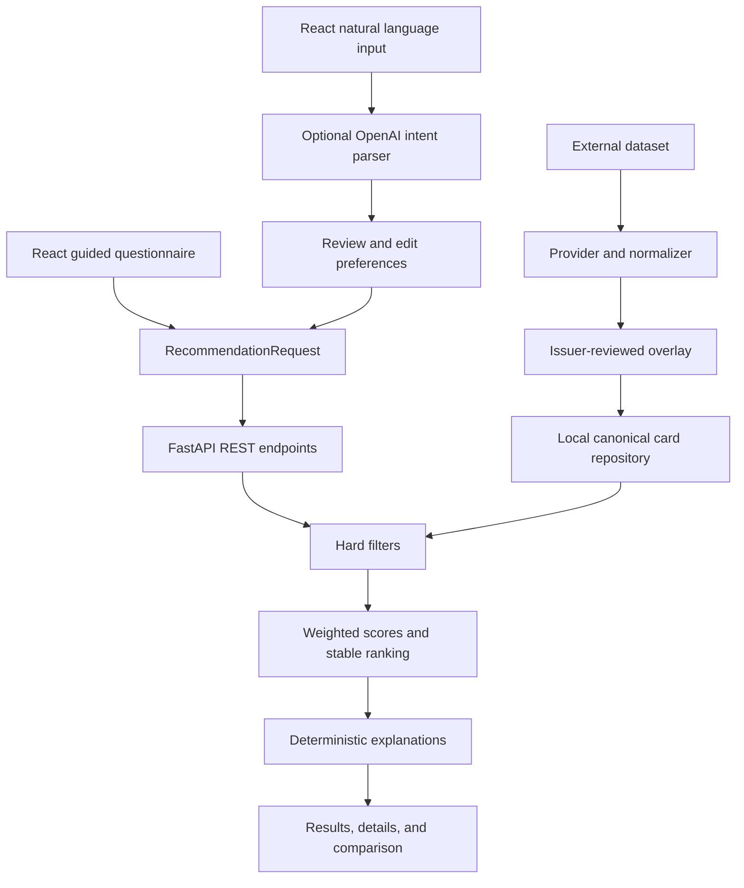

# CardMatch — AI-Powered Credit Card Recommender

A React/TypeScript and FastAPI application that compares credit cards against your
goals, spending, and constraints. Guided search works entirely without OpenAI.
Optional AI interprets natural language into the same typed request; it never
independently ranks cards or invents card facts.

Implemented from [the project brief](credit_card_recommender_codex_plan.md).

## Run locally

Requirements: Python 3.12+ and Node.js 22.20+ (or another Vite-compatible release).
Use npm 11 if npm 10 encounters a peer-dependency resolver error.

From the repository root in PowerShell:

```powershell
python -m venv .venv
.venv\Scripts\python.exe -m pip install -c backend/constraints.txt -e './backend[dev]'
cd frontend
npx --yes npm@11 ci
cd ..
python scripts/dev.py
```

Open **http://127.0.0.1:5173**. Interactive API documentation is at
**http://127.0.0.1:8000/docs**. Ctrl+C stops both servers. The frontend updates while
editing; restart the launcher after changing backend code or card data.

On macOS/Linux, use `.venv/bin/python` instead of `.venv\Scripts\python.exe`.
Alternatively, run these in separate terminals:

```powershell
# Terminal 1, from the repository root
.venv\Scripts\python.exe -m uvicorn app.main:app --app-dir backend --reload
# Terminal 2
cd frontend
npm run dev
```

No `.env` file or API key is needed for Guided mode.

## What is included

- Five-step questionnaire with optional spending, fees, travel, credit profile,
  student preference, simple rewards, intro APR, and issuer exclusions.
- Deterministic rankings, match-score breakdowns and weights, explanations,
  tradeoffs, annual reward estimates, details, and responsive comparison views.
- Six reviewed consumer cards across two issuers, normalized from an external
  dataset. This is an initial collection, not a market-wide comparison.
- Optional structured AI parser, visible/editable interpretation, bounded follow-ups,
  conflict handling, and graceful Guided-mode fallback.
- Backend unit/integration tests, frontend component tests, real desktop/mobile
  browser tests, and GitHub Actions that require no OpenAI credentials.

## Architecture



Business logic lives in `backend/app/services`, independent of route handlers.
Pydantic defines the backend contracts; matching TypeScript interfaces are in
`frontend/src/types`. The frontend contains presentation logic, not scoring rules.
No database, authentication, bank connection, RAG, or agent framework is required.

## Card data and provenance

The source snapshot comes from the [67.CREDIT dataset](https://67.credit/data),
licensed under [CC BY 4.0](https://creativecommons.org/licenses/by/4.0/).
Attribution is also displayed in the app footer. `source-67credit.json` retains the
source snapshot, `reviews.json` holds issuer-reviewed corrections and supported
reward rules, and `cards.json` is the canonical output.

The canonical `CreditCard` model validates IDs, issuer/name, card type, annual fee,
foreign fee, reward rules, APR durations, optional welcome offers, tags, provenance
URLs, active status, and verification dates. Unknown values remain null.

From `backend/` with the virtual environment active:

```sh
python -m scripts.import_cards           # reproducible, offline
python -m scripts.import_cards --refresh # explicit external refresh
```

Imports validate the complete dataset and replace it atomically. The request path
never fetches external card data. The importer does not invent unsupported terms
or advance issuer-review dates automatically. See [data provenance and the path to
100+ cards](docs/data-provenance.md) for the review policy and current limitations.

## Ranking and estimates

Algorithm version **1.0** first filters inactive/business cards, fee limits, excluded
issuers, student requirements, and strict foreign-fee requirements. Unverified
foreign fees fail a strict no-foreign-fee constraint. Student cards require student
status or the student goal. Secured cards are considered for credit-building goals
or new/fair credit profiles.

Eight components are scored from 0–1, then combined using centralized goal-specific
weights in `scoring.py`. The API exposes a 0–100 Match Score, individual components,
and weights. Unrequested preferences receive neutral scores, so a 100 for an
unrequested component does not assert a particular benefit exists. Unknown credit
profile receives a neutral 0.5 signal. Credit profile is never a credit pull or an
approval prediction.

Ties resolve by score descending, reward fit descending, annual fee ascending, and
card ID ascending. Identical inputs and data produce identical results.

Reward estimates use monthly spending × 12 and the modeled category/base rates.
Category caps fall back to the base rate. Venture miles use a one-cent travel
valuation. Net value subtracts the annual fee. No spending means no dollar estimate;
rewards fit uses only the base rate. Interest, welcome offers, credits, transfer
partners, streaming, and portal-only bonuses are excluded. Merchant exclusions apply.

## Optional AI

The [non-AI completion gate](docs/non-ai-gate.md) passed before the SDK was added.
OpenAI remains an optional dependency:

```powershell
.venv\Scripts\python.exe -m pip install -c backend/constraints.txt -e './backend[dev,ai]'
Copy-Item backend/.env.example backend/.env
```

Edit `backend/.env` locally:

```dotenv
ENABLE_OPENAI=true
OPENAI_API_KEY=your-server-side-key
OPENAI_MODEL=your-structured-output-capable-model
```

Choose a model available to your account that supports Responses Structured Outputs.
The implementation follows [OpenAI's structured-output documentation](https://developers.openai.com/api/docs/guides/structured-outputs?api-mode=responses)
and uses `responses.parse` with Pydantic, a 20-second timeout, no automatic retries,
and `store=false`. The SDK is imported only inside the optional parser.

Restart the backend after configuration changes. `/api/v1/ai/status` exposes only
availability, never credentials. A missing key, disabled feature, missing SDK, refusal,
timeout, malformed response, or rate limit leaves Guided mode available. Descriptions
are limited to 2,000 characters and two follow-ups. Explicit conflicts block ranking
until clarified. Parsed preferences are validated again before entering the engine.

The UI previews interpretation and lets users edit it before displaying matches.
Normal tests use fake parsers and an HTTP-mocked real SDK, never paid calls.
**Live OpenAI behavior has not been verified with an account key.**

| Variable | Default | Purpose |
| --- | --- | --- |
| `CORS_ORIGINS` | localhost/127.0.0.1 port 5173 | JSON array of allowed frontend origins |
| `ENABLE_OPENAI` | `false` | Explicit feature switch |
| `OPENAI_API_KEY` | empty | Backend-only secret |
| `OPENAI_MODEL` | empty | Configurable structured-output-capable model |

`.env` files are ignored. Preferences live in browser memory and reset on refresh;
the backend does not persist them. AI descriptions are sent to OpenAI only on submit.
Do not enter card numbers, bank credentials, passwords, or Social Security numbers.

## API

| Method | Endpoint | Purpose |
| --- | --- | --- |
| GET | `/api/v1/health` | Health check |
| GET | `/api/v1/cards` | Active consumer catalog |
| GET | `/api/v1/cards/{id}` | Card details; 404 for missing cards |
| POST | `/api/v1/recommendations` | Validated preferences → deterministic matches |
| GET | `/api/v1/ai/status` | AI availability |
| POST | `/api/v1/ai/recommendations` | Natural language → interpreted preferences and same-engine results |

Example request:

```json
{
  "primary_goal": "cash_back",
  "monthly_spending": {"groceries": 350, "dining": 200},
  "max_annual_fee": 0,
  "credit_profile": "unknown",
  "top_n": 3
}
```

Responses include `preferences`, `recommendations`, `compared_count`, `eligible_count`,
`algorithm_version`, and notices. Invalid inputs return 422. A valid search with no
matches returns 200 with an empty list; hard constraints are never relaxed silently.

## Verification

Use the virtual environment's Python (or activate it first). From `backend/`:

```sh
python -m ruff check . ../scripts
python -m ruff format --check . ../scripts
python -m mypy app scripts
python -m pytest -q
```

Mypy for the optional adapter requires the `ai` extra. SDK transport tests skip when
it is absent; all core and fake-parser integration tests still run.

From `frontend/`:

```sh
npm run format:check
npm run lint
npm run typecheck
npm run test
npm run build
npx playwright install chromium
npm run test:e2e
```

Playwright starts and stops both servers; leave ports 8000 and 5173 free. On Windows,
an installed Edge can be used with `$env:PLAYWRIGHT_CHANNEL='msedge'`. Screenshots and
failure traces are generated in ignored `frontend/test-results/`. CI uses Chromium
and runs a separate backend job with no OpenAI SDK installed.

Verified locally: 67 backend tests, 6 frontend tests, and 10 desktop/mobile browser
tests; lint/type checks and production build pass. AI tests are mocked. GitHub Actions
is configured but has not been run remotely from this workspace.

The frontend lockfile and `backend/constraints.txt` record tested dependencies.
An esbuild override supplies a Windows security fix while retaining Vite 7.

## Hosting and limitations

See [deployment instructions](docs/deployment.md) for Python hosting, static assets,
SPA route fallbacks, and the `/api` reverse proxy. No external deployment was created.
The catalog has six reviewed cards, with intentionally limited issuer coverage.
Scores are a transparent heuristic, not financial advice or a complete optimization
of redemption value. Results do not account for debt interest, approval rules,
income, or every benefit. Accounts, saved searches, real-time issuer scraping,
automatic applications, affiliate links, and AI explanation rewriting are deferred.

Recommendations are informational. Card terms and offers change. Verify current
issuer terms before applying. No recommendation or Match Score guarantees approval.
